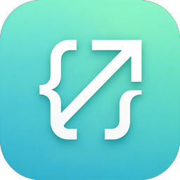
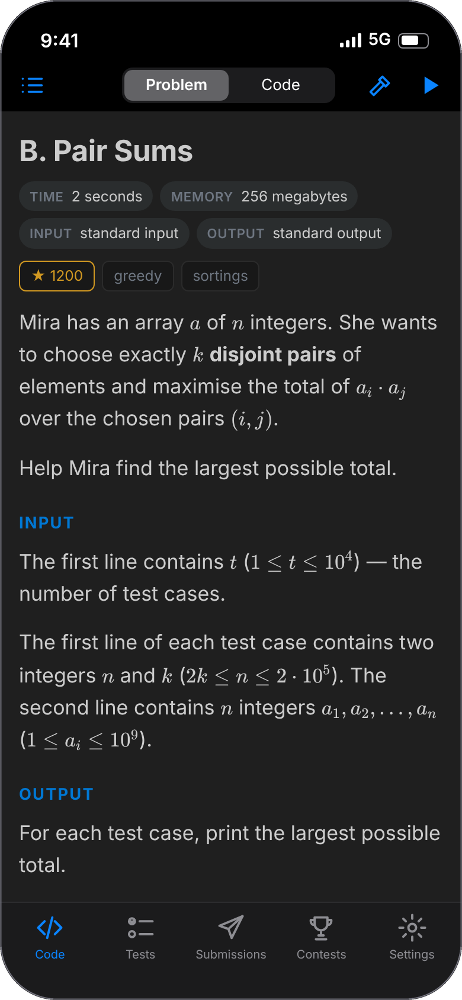
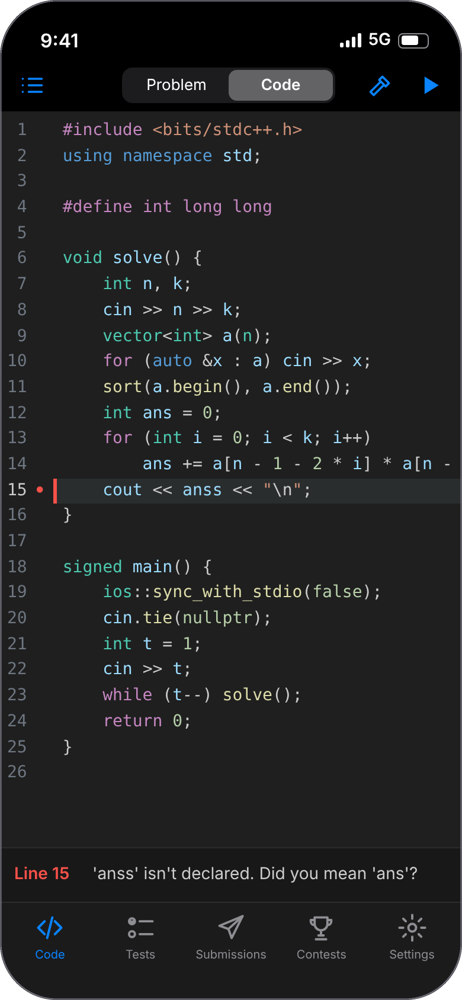
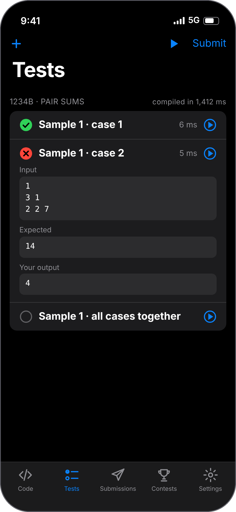
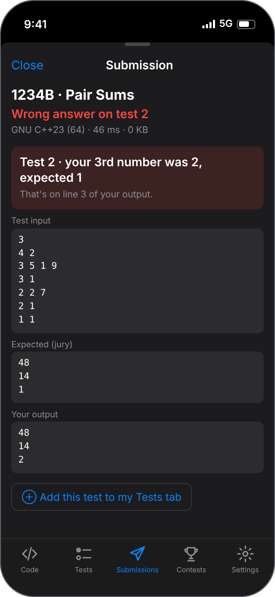
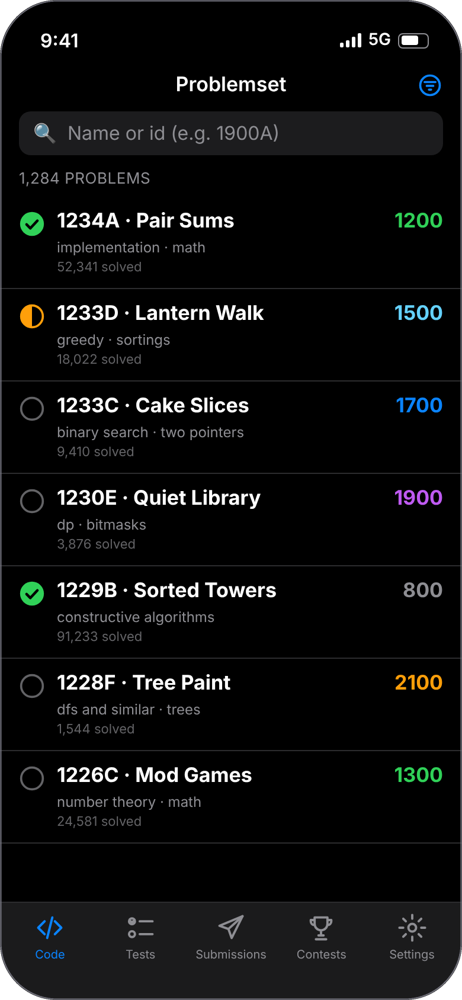
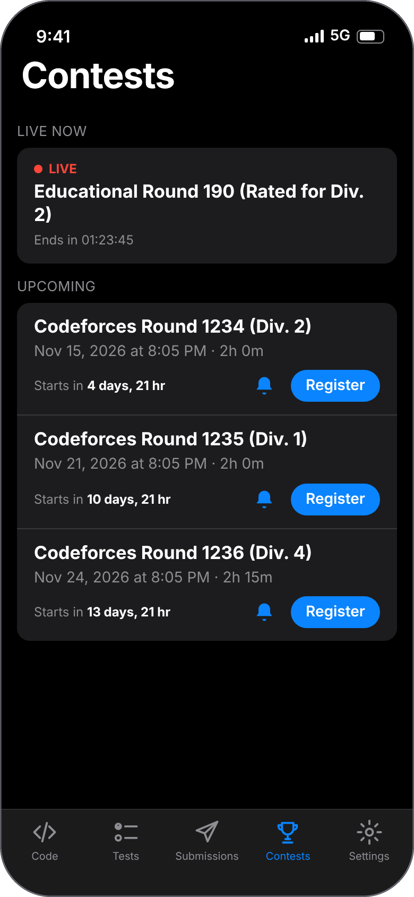
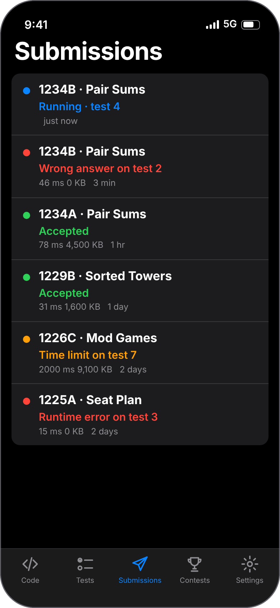
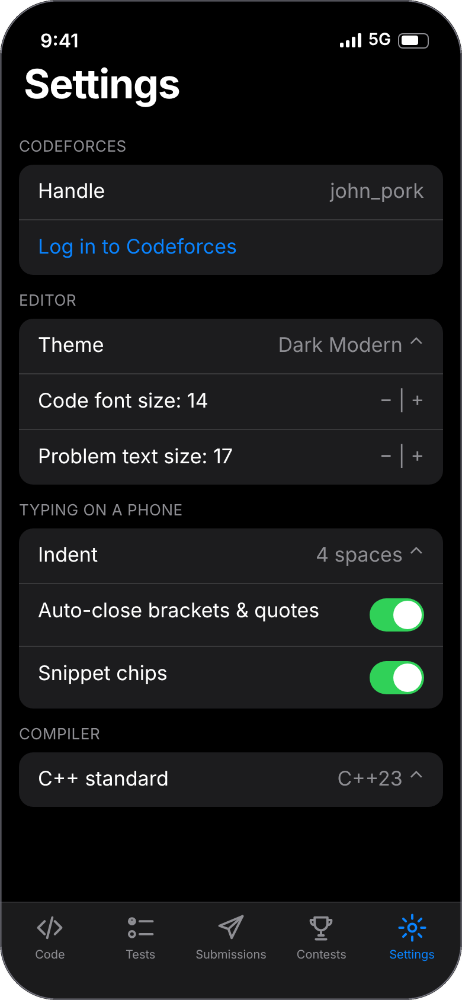

# CF Mobile

**Solve Codeforces problems entirely on your iPhone.**
Read the statement, write C++ in a real editor, test it, and submit — no laptop, no browser tabs, no paid account.

[Install guide](#install-on-your-iphone) · [Features](#what-it-does) · [FAQ](#faq)

<table>
<tr>
<td align="center"> <b>Read the problem</b> math, examples, copy buttons</td>
<td align="center"> <b>Write C++</b> one-line errors, red line mark</td>
<td align="center"> <b>Test each case</b> samples split per case</td>
<td align="center"> <b>See what failed</b> exact test, no browser</td>
</tr>
<tr>
<td align="center"> <b>Browse problems</b> rating, tags, solved</td>
<td align="center"> <b>Contests</b> register, reminders</td>
<td align="center"> <b>Live verdicts</b> updates while judging</td>
<td align="center"> <b>Make it yours</b> themes, typing aids, template</td>
</tr>
</table>

Screenshots are illustrative renderings with demo data (demo user <code>john_pork</code>, made-up problems), not a real account.

---

## What it does

| | |
|---|---|
| 📖 **Read problems in the app** | Statements render with proper math, examples and a copy button. Switch between **Problem** and **Code** with one tap. |
| ⌨️ **A real C++ editor** | VS Code-style themes (Dark Modern, Dark+, Light Modern, One Dark, Dracula, Monokai, GitHub Dark), line numbers, auto-indent, a symbol row above the keyboard, comment/duplicate/move-line buttons. No autocomplete — you write the code. |
| ⚙️ **Compiles on your phone** | Clang 22 (C++23/20/17/14) runs on-device through WebAssembly. Works offline. No server, no cost. |
| 🔴 **Errors you can actually read** | One short sentence and a red mark on the exact line — *"Line 9 · Integer overflow on × (use long long)"* — instead of a wall of compiler output. Catches overflow and out-of-bounds while testing. |
| ✅ **Tests** | Samples load automatically. Multi-case samples (`t` test cases) are split into one test per case. Add your own tests, run one or all, see AC / WA / TLE / RE with a diff. |
| 🚀 **Submit** | Submit straight from the Tests tab. |
| 📊 **Submissions** | Live verdicts. Tap a failed one to see **which test failed, the input, the expected answer and yours**, and why they differ. |
| 🗂 **Problemset browser** | Search and filter by rating, tags and solved/unsolved, just like on the site. |
| 📈 **Profile & stats** | Your rating graph, **daily streak**, a yearly activity heatmap, and CF Analytics-style charts: solved by rating, tag and problem letter, verdicts, languages, and problems you tried but haven't solved. |
| 🏆 **Contests** | Live and upcoming contests, one-tap register, reminders 24 h and 15 min before, live-contest problem list. |
| 📝 **Your template** | Import a `.cpp`/`.txt` file or edit it in the app; it opens with every new problem. |

> **Not affiliated with Codeforces.** This is an unofficial, community project.

---

## Install on your iPhone

The app isn't on the App Store. You install the `.ipa` file yourself using a free tool that signs it with **your own Apple ID** (no paid developer account needed).

### 1. Download the app

**[⬇️ Download CFMobile.ipa](../../releases/latest/download/CFMobile.ipa)** (about 27 MB)

Direct link to share: `https://github.com/Aerialsamurai/cfmobile/releases/latest/download/CFMobile.ipa`

It's rebuilt automatically from the source in this repository; the release page shows which commit it came from.

### 2. Install it with Sideloadly (easiest)

Works on **Windows and Mac**.

1. Install **iTunes** from [apple.com](https://www.apple.com/itunes/) (Windows only — *not* the Microsoft Store version).
2. Download and install **[Sideloadly](https://sideloadly.io)**.
3. Plug in your iPhone, unlock it and tap **Trust**.
4. Open Sideloadly, drag **CFMobile.ipa** onto it, enter your **Apple ID**, press **Start**, and enter your password / 2FA code when asked.
5. On the iPhone: **Settings → General → VPN & Device Management** → tap your Apple ID → **Trust**.
6. **Settings → Privacy & Security → Developer Mode** → turn on (the phone restarts).
7. Open **CF Mobile**.

### Keeping it working (free Apple ID)

Apps signed with a free Apple ID **expire after 7 days**. When that happens the icon stays but the app won't open. Re-run Sideloadly with the same IPA and it works again; your saved problems and settings should be kept.

To avoid doing this by hand, use **[AltStore](https://altstore.io)** instead of Sideloadly. Keep AltServer running on your PC/Mac (same Wi-Fi as the phone) and it refreshes the app automatically in the background.

> A free Apple ID allows 3 sideloaded apps at once and about 10 new App IDs per week.

**Requirements:** iPhone on **iOS 16 or later**. Developed and tested on an iPhone 13.

---

## Using it

1. **Settings → Log in to Codeforces.** You type your password on codeforces.com itself, inside the app. It's never seen or stored by this app.
2. **Code tab → list icon.** Paste a problem link (e.g. `https://codeforces.com/contest/1900/problem/A`) or tap **Browse problemset**.
3. Read the statement, tap **Code**, and write your solution.
4. Tap the **hammer** to check for errors, or the **▶** button to run all tests.
5. In the **Tests** tab press **Submit**.
6. Watch the verdict in **Submissions**.

**Template:** *Settings → Template*. Import a file, or edit `template.cpp` in the Files app under *On My iPhone → CF Mobile*.

**Typing tip:** turn off Smart Punctuation, Auto-Correction and Predictive Text in *iOS Settings → General → Keyboard*, and hold the space bar to move the cursor like a trackpad.

---

## FAQ

**Does it need internet?**
Only for Codeforces features (importing, submitting, contests, submissions). Editing, compiling and running tests work offline.

**Why does the first compile take a few seconds?**
It loads a ~100 MB compiler. After that it's about a second or two.

**Will my solution behave exactly like on Codeforces?**
Almost always, but not identically. The phone compiler is 32-bit WebAssembly, so:
- `try` / `catch` / `throw` (C++ exceptions) are **not supported**.
- Programs run slower than on Codeforces, so a TLE on the phone doesn't prove a TLE there.
- The overflow/index checks are a debugging aid that you can turn off in Settings.

**Submit or Register stopped working.**
They drive the real codeforces.com site, so a layout change can break the auto-fill. The page stays visible so you can finish by hand. Please [open an issue](../../issues).

**Is it safe? Does it collect anything?**
No analytics, no accounts, no servers of mine. Your code, problems and settings stay on your phone. Codeforces data is fetched directly from codeforces.com.

**Why isn't it on the App Store?**
Publishing needs a paid developer account, and an app that automates a third-party website may not pass review. Sideloading keeps it free for everyone.

---

## Build it yourself

You don't need a Mac. GitHub builds the app on its own macOS machines.

1. **Fork** this repository.
2. In your fork, open **Actions**, enable workflows, and run **Build iOS app (unsigned IPA)** (or push any commit).
3. When it finishes, your fork's **Releases** page has the IPA.

Locally (Mac with Xcode): `cd Web && npm install && node build.mjs && cp -R dist ../CFPhone/web`, then `brew install xcodegen && xcodegen generate` and open `CFPhone.xcodeproj`.

### How it's put together

- `CFPhone/` — SwiftUI app (tabs, Codeforces API, login/submit flows, notifications, a tiny loopback web server).
- `Web/` — the editor (CodeMirror 6), the problem reader (KaTeX), and the compiler glue. Runs inside web views.
- Clang/LLD for WebAssembly comes from the [`@yowasp/clang`](https://github.com/YoWASP/clang) package.
- Runtime overflow/bounds checks are small custom handlers (`Web/src/ubhandlers.js`) since the WASI sysroot has no sanitizer runtime.
- `Web/src/diagnostics.js` turns compiler output into the short messages.

Contributions are welcome — especially fixes for Codeforces page changes, new themes, and support for other judges.

## Support the project

CF Mobile is free and open source. If it helps you:

- ⭐ **[Star the repo](https://github.com/Aerialsamurai/cfmobile)** — the easiest way to help others find it.
- 📣 Share it with a friend or your CP club: `https://github.com/Aerialsamurai/cfmobile/releases/latest/download/CFMobile.ipa`
- 🐛 [Report a bug or suggest a feature](../../issues).

---

## Credits

LLVM/Clang (Apache-2.0 with LLVM exception) via YoWASP · [CodeMirror](https://codemirror.net) (MIT) · [KaTeX](https://katex.org) (MIT) · [browser_wasi_shim](https://github.com/bjorn3/browser_wasi_shim) (MIT/Apache-2.0).
"Codeforces" is a trademark of its owners; this project is not endorsed by them.
